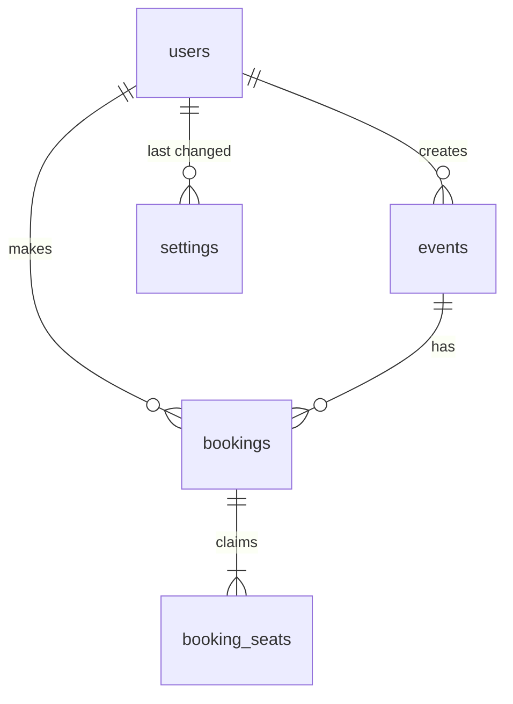

# Event Seat Booking

Attendees pick seats on a live seat map, hold them for a few minutes while they confirm, and see
their booking history with cancellation. **Organizers** set up events and seating grids and change
the booking rules. Two people can never hold the same seat, even when they click at the same
moment: the database refuses the second claim.

The requirements come from `3-Project-Event-Seat-Booking.pdf`. The spec, plan and task list are in
[`specs/`](specs/), written with GitHub Spec Kit.

## Project location

Everything for this task lives in `task-3-event-seat-booking/`, and every command below runs from
that folder.

## Prerequisites

- Node.js 22 LTS
- PostgreSQL 16 or newer installed on your machine (built and tested on PostgreSQL 17). Any client
  such as DBeaver or psql can be used to look at the data.

## Setup

1. **Environment.** One `.env` file in this folder is read by the API and the frontend.

   ```bash
   cp .env.example .env
   ```

   Set `DB_PASSWORD` (and `DB_USER`, `DB_HOST` or `DB_PORT` if yours differ from
   `postgres@localhost:5432`). The API runs on 3040 and the frontend on 5176, so this project can run
   next to tasks 1 and 2.

2. **Database.** Create an empty database named after `DB_NAME`, in DBeaver (right-click
   *Databases* → *Create New Database*) or with psql:

   ```bash
   psql -h localhost -U postgres -c "CREATE DATABASE seat_booking"
   ```

   The tests create their own `DB_NAME_TEST` database, so you don't need to create that one.

3. **Backend.** Install, create the schema and load the demo data:

   ```bash
   cd backend && npm install && npm run migration:run && npm run seed
   ```

4. **Frontend.**

   ```bash
   cd frontend && npm install
   ```

## Running

API, with Swagger UI at `http://localhost:3040/api/docs`:

```bash
cd backend && npm run start:dev
```

Frontend, at `http://localhost:5176`:

```bash
cd frontend && npm run dev
```

### Demo accounts (created by `npm run seed`, demo only)

All accounts use the password set in `SEED_DEMO_PASSWORD` in `.env`. Never reuse it for real accounts. The sign-in page lists the organizer and attendee demo logins with a **Use** button that fills in the form; it shows the password from `VITE_DEMO_PASSWORD` (which points at `SEED_DEMO_PASSWORD`). Leave `VITE_DEMO_PASSWORD` empty to hide the box, for example outside a demo.

| Account | Role | What you'll see |
|---------|------|-----------------|
| `organizer@example.test` | Organizer | Both events with live counts, New event, Edit, Settings |
| `attendee1@example.test` … `attendee12@example.test` | Attendee | Seat maps you can book from, and your own history |

The seed creates two events, 3 and 5 weeks after the day it runs, at 19:00 in the seeding machine's
time zone: **Riverside Jazz Night** (10 rows × 12 = 120 seats) and **Tech Talks: Building for
Scale** (6 × 10 = 60 seats). It also creates 30 bookings: 24 confirmed and 6 cancelled. Running it
a second time does nothing.

To watch the live map, sign in as two different attendees in two browser tabs (each tab keeps its
own session). Then hold a seat in one tab and watch it change in the other.

## Running the tests

The database must be running. The e2e tests create and migrate their own `DB_NAME_TEST` database
and empty it before each test file, so your data is never touched.

```bash
cd backend && npm run test:all
```

| Command | What it runs |
|---------|--------------|
| `npm test` | Unit tests: `src/bookings/utils/booking-rules.util.spec.ts` (no database) |
| `npm run test:e2e` | API tests: `test/*.e2e-spec.ts`, using `test/jest-e2e.json` |
| `npm run test:all` | Both |

Every test name starts with the spec test ID it proves, for example `T-RACE-01`. The e2e tests use a
fixed clock (`2026-03-10T12:00:00Z`) and run the expiry job themselves.

**Last run (2026-11-04): 44 tests passing (7 unit and 37 e2e).** The "Done means" criteria:

| Criterion | Tests |
|-----------|-------|
| The concurrency test passes reliably | `T-RACE-01` (2 attendees, same seat, 25 rounds), `T-RACE-02` (10 attendees at once), `T-RACE-03` (overlapping multi-seat holds are all or nothing) |
| Expired holds release on time | `T-EXP-01` (held at 12:04:59.999, free at 12:05:00.000), `T-EXP-02` (the job releases at exactly the expiry instant), `T-EXP-03` |
| The interface cannot bypass the check | `T-RACE-04` (a second claim written straight to the database is refused) |
| Configuration changes behaviour with no code change | `T-CFG-03` (max seats), `T-CFG-04` (hold duration) |

## Where double booking is stopped, and why the interface cannot bypass it

A seat is claimed by a row in `booking_seats`. A claim is **active** while `released_at` is null.
The migration creates this index:

```sql
CREATE UNIQUE INDEX ux_booking_seats_active_seat
  ON booking_seats (event_id, seat_row, seat_number) WHERE released_at IS NULL;
```

1. **The database is the guarantee.** PostgreSQL checks this index on every insert, from every
   connection, inside the transaction. When two holds insert the same seat at once, the second
   insert waits for the first transaction. It then fails if the first commits, or goes ahead if the
   first rolls back. Nothing can write a second active claim: not a modified client, not a direct
   API call, not a bug in the service. `T-RACE-04` writes one with raw SQL and the database refuses it.
2. **The service gives friendly errors.** `BookingsService.hold` checks the seats first so it can
   name the taken ones. Two requests can both pass this check at the same moment. The index then
   refuses one of them, and the service turns PostgreSQL error `23505` into `409 SEAT_UNAVAILABLE`.
   In the race tests, most losing requests are refused by the index, not by the pre-check.
3. **The interface is only a convenience.** The seat map disables seats that are not available.
   Nothing relies on that.

A hold writes all its claims in one transaction, so it gets every seat or none. Claims are inserted
in seat order, so two overlapping holds always meet on the same first seat and cannot deadlock. The
hold transaction locks the event `FOR SHARE`, and a grid change locks it `FOR UPDATE`. Holds still
run side by side, but the grid cannot shrink under a hold that is being written.

A second partial unique index, `ux_bookings_one_active_hold`, allows one active hold per attendee
per event, so a double click cannot create two holds.

## How holds expire on time

- A hold is expired from the exact instant `now >= hold_expires_at`. Every seat-map read counts a held claim only while `hold_expires_at > now`, so the seat shows as free at 12:05:00 even if nothing has run yet.
- Every new hold first releases the expired holds on its event, in the same transaction. An expired hold therefore never blocks the unique index.
- A background job (`HoldExpiryService`, every `HOLD_SWEEP_INTERVAL_SECONDS`) marks expired holds `expired`, sets `released_at` to the hold's own expiry time rather than the time the job ran, and notifies the live seat maps.
- Confirming after the expiry instant is refused with `HOLD_EXPIRED`.
- The clock is injected (`CLOCK`), so the tests set it to 12:04:59.999 and 12:05:00 and check each side of the boundary.

## Live seat map

`GET /api/events/:id/seats/stream` is a Server-Sent Events stream. It sends `ready` on connect,
`changed` whenever a hold, release, confirmation, cancellation, expiry or grid change touches that
event, and `ping` every 25 seconds. The page reloads the seat map on `ready` and `changed`, and
reconnects after 2 seconds if the stream drops. The browser reads the stream with `fetch`, so the
bearer token goes in a header and never in the URL. The seat map response includes `serverTime`, so
the hold countdown follows the server's clock, not the browser's. The change bus is in-process. Running
several API processes would need a shared channel such as PostgreSQL `LISTEN/NOTIFY`.

## Architecture

```text
backend/src/              NestJS 11 + TypeORM 0.3, one module per feature
  auth/                   JWT sign-in; global JWT guard and roles guard (@Roles, @Public, @CurrentUser)
  users/  settings/       accounts; organizer-configurable holdDurationMinutes and maxSeatsPerBooking
  events/                 create, edit (grid changes refused with SEATS_IN_USE), list with counts, seat map
  bookings/               hold, confirm, release, history, cancel; hold-expiry.service.ts
    seat-claims.ts        occupied seats, counts, releaseExpiredHolds (shared by events and bookings)
    utils/                pure seat rules + their unit tests
  seat-updates/           change bus and the SSE stream endpoint
  common/                 clock, error envelope, exception filter, validation pipe, trim decorators
  config/  database/      env validation; data source, migrations/, seeds/
backend/test/             *.e2e-spec.ts, support/ (test app with fixed clock, factories, booking world)
frontend/src/             React 18 + Vite + Material UI
  events/                 events list, event page, seat map, hold panel with countdown, stream hook
  bookings/  settings/    booking history with cancel; organizer settings
specs/                    spec.md, plan.md, tasks.md
```

**How a request is handled**, in order:

1. Global JWT guard: is the caller signed in?
2. Roles guard: does the caller's role allow this route? (Organizers manage events and settings; attendees hold, confirm and cancel.)
3. DTO validation.
4. The service loads the item and checks ownership (an attendee can only act on their own holds and bookings).
5. Rules, in a transaction, with the database constraints as the last line.

**Errors** always have the shape `{ "error": { "code", "reason?", "message", "details?" } }`. The
codes are `UNAUTHENTICATED` 401, `FORBIDDEN` 403, `NOT_FOUND` 404, `VALIDATION_ERROR` 400 and
`RULE_VIOLATION` 409. For `RULE_VIOLATION`, `reason` is one of `SEAT_UNAVAILABLE`,
`SEAT_LIMIT_EXCEEDED`, `HOLD_EXISTS`, `HOLD_EXPIRED`, `INVALID_STATE`, `EVENT_CLOSED` or
`SEATS_IN_USE`.

## Data model



| Table | Columns | Rules enforced by the database |
|-------|---------|--------------------------------|
| `users` | `id`, `email`, `name`, `password_hash` (bcrypt), `role` (`attendee`/`organizer`), `created_at` | unique lower-case email |
| `settings` | `key`, `value`, `updated_by`, `updated_at` | one row per setting; defaults apply when a row is missing |
| `events` | `id`, `name`, `description`, `venue`, `starts_at`, `seat_rows`, `seats_per_row`, `created_by`, timestamps | 1–26 rows, 1–50 seats per row, non-blank name and venue |
| `bookings` | `id`, `event_id`, `attendee_id`, `status` (`held`/`confirmed`/`expired`/`cancelled`), `hold_expires_at`, `confirmed_at`, `cancelled_at`, timestamps | one `held` booking per attendee per event; confirmed and cancelled times present for those states |
| `booking_seats` | `booking_id`, `event_id`, `seat_row`, `seat_number`, `released_at` | **one active claim per seat**; `(booking_id, event_id)` must match the booking |

A hold is a booking in status `held`. Seats are not rows of their own: a seat is
`(event, row, number)` inside the event's grid, labelled `A1`, `C7` and so on. Seat status and seat
counts are calculated on every read and never stored.

Schema changes go through TypeORM migrations in `backend/src/database/migrations/`.
